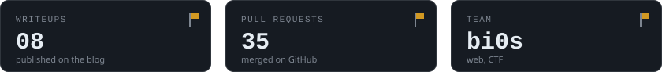

<!-- The visuals in assets/ are generated: edit the data in scripts/build.py and run it. -->

<picture>
  <source media="(prefers-color-scheme: dark)" srcset="assets/hero-dark.svg">
  <source media="(prefers-color-scheme: light)" srcset="assets/hero-light.svg">
  
</picture>

  
  
  
  

<picture>
  <source media="(prefers-color-scheme: dark)" srcset="assets/hud-dark.svg">
  <source media="(prefers-color-scheme: light)" srcset="assets/hud-light.svg">
  
</picture>

I'm a student who spends most of my time on security research and playing CTFs with [bi0s](https://bi0s.in), mostly on the web side, and recently poking at AI security too. I write up what I find so the next person can skip a wall I already walked into.

<picture><source media="(prefers-color-scheme: dark)" srcset="assets/divider-dark.svg"><source media="(prefers-color-scheme: light)" srcset="assets/divider-light.svg"></picture>

### Projects

<table>
<tr>
<td width="33%" valign="top">

 
VS Code extension that checks every pinned dependency in <code>requirements.txt</code> against PyPI for new versions and OSV.dev for known vulnerabilities, and highlights them inline.
  
<a href="https://github.com/k0w4lzk1/Out-Py">Code</a>
</td>
<td width="33%" valign="top">

 
Personal health management app for rural communities in India, built around low digital literacy, patchy internet and language barriers.
  
<a href="https://github.com/k0w4lzk1/DHWANI">Code</a>
</td>
<td width="33%" valign="top">

 
Implementation and critique of the LangurTrace forensics paper, with a report on the gaps we found.
  
<a href="https://github.com/k0w4lzk1/LangurTrace-Implementation">Code</a>
</td>
</tr>
</table>

<picture><source media="(prefers-color-scheme: dark)" srcset="assets/divider-dark.svg"><source media="(prefers-color-scheme: light)" srcset="assets/divider-light.svg"></picture>

### Writeups

| Event | Post |
| :-- | :-- |
| Intigriti 0526 | [Challenge 0526](https://k0w4lzk1.vercel.app/blog/Intigriti) |
| LACTF 2026 | [append-note and extend-note](https://k0w4lzk1.vercel.app/blog/lactf26) |
| UofTCTF 2026 | [Writeup](https://k0w4lzk1.vercel.app/blog/UofTCTF26) |
| SECCON | [Writeups](https://k0w4lzk1.vercel.app/blog/Seccon-writeups) |
| BuckeyeCTF 2025 | [Writeup](https://k0w4lzk1.vercel.app/blog/buckeyectf25) |
| QnQSec 2025 | [Writeup](https://k0w4lzk1.vercel.app/blog/QnQSec25-writeup) |
| UIUCTF 2025 | [Writeup](https://k0w4lzk1.vercel.app/blog/Uiuctf25) |
| LakeCTF 2024 | [yascc](https://k0w4lzk1.vercel.app/blog/LakeCtf24-yascc) |

<picture><source media="(prefers-color-scheme: dark)" srcset="assets/divider-dark.svg"><source media="(prefers-color-scheme: light)" srcset="assets/divider-light.svg"></picture>

X <a href="https://x.com/k0w4lzk1">@k0w4lzk1</a> · Discord @k0w4lzk1

