student. i do web security and play ctfs with [bi0s](https://bi0s.in), mostly client-side stuff, and lately poking at ai security too.

**writeups:**
[intigriti 0526](https://k0w4lzk1.vercel.app/blog/Intigriti) ·
[lactf 26](https://k0w4lzk1.vercel.app/blog/lactf26) ·
[uoftctf 26](https://k0w4lzk1.vercel.app/blog/UofTCTF26) ·
[seccon](https://k0w4lzk1.vercel.app/blog/Seccon-writeups) ·
[buckeyectf 25](https://k0w4lzk1.vercel.app/blog/buckeyectf25) ·
[qnqsec 25](https://k0w4lzk1.vercel.app/blog/QnQSec25-writeup) ·
[uiuctf 25](https://k0w4lzk1.vercel.app/blog/Uiuctf25) ·
[lakectf 24](https://k0w4lzk1.vercel.app/blog/LakeCtf24-yascc)

**things i built:**
[out-py](https://github.com/k0w4lzk1/Out-Py), a vs code extension that flags outdated and vulnerable packages in `requirements.txt` ·
[dhwani](https://github.com/k0w4lzk1/DHWANI), a health app for rural india ·
[langurtrace](https://github.com/k0w4lzk1/LangurTrace-Implementation), a forensics paper reimplemented and picked apart

[blog](https://k0w4lzk1.vercel.app) · [x](https://x.com/k0w4lzk1) · discord @k0w4lzk1
