<p align="center">
  
</p>

```
PLAYER 1   k0w4lzk1
TEAM       bi0s
CLASS      web security
SPECIALS   xss · xs-leaks · client-side weirdness
```

### ▸ Level select

| | | |
|---|---|---|
| 🚩 **Writeups** | CTF writeups and security notes | [k0w4lzk1.vercel.app](https://k0w4lzk1.vercel.app) |
| 🧩 **Out-Py** | VS Code extension that checks `requirements.txt` against PyPI and OSV.dev | [repo](https://github.com/k0w4lzk1/Out-Py) |
| 🩺 **DHWANI** | AI-assisted health management app for rural communities in India | [repo](https://github.com/k0w4lzk1/DHWANI) |
| 🔬 **LangurTrace** | Implementation and critique of the LangurTrace forensics paper | [repo](https://github.com/k0w4lzk1/LangurTrace-Implementation) |

### ▸ Recent runs

- **Intigriti 0526**: popping `alert(1)`
- **LACTF 2026**: append-note and extend-note, XS-Leaks through an oracle

More on the [blog](https://k0w4lzk1.vercel.app).

### ▸ Insert coin

Play CTFs with [team bi0s](https://bi0s.in). Reach me through the blog.
